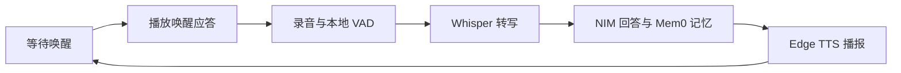

# LLM_Mem0 · 拾忆个人助理

**当前版本：[v1.21](https://github.com/zhangfanxp/LLM_Mem0/releases/tag/v1.21)**

一个在本机运行的单用户网页助理，支持中文流式对话、长期记忆和语音交互。说出自定义唤醒词，听到应答后提问；助理会在讲话结束后自动转写、回答并播报。

Python 后端运行在你的电脑上，对话、长期记忆、语音转写和语音合成分别使用在线服务。

## 功能概览

| 功能 | 说明 |
| --- | --- |
| 流式对话 | 通过 NVIDIA NIM 切换模型，逐步显示回答文字 |
| 长期记忆 | 使用 Mem0 Platform 检索、整理偏好与项目背景，支持搜索、手动保存和删除 |
| 自定义唤醒 | 默认“你好迦童”，支持中文同音匹配，例如“童童大王”与“同同大王” |
| 唤醒应答 | 默认播报“你好，主人您有什么吩咐”，文字和音色均可配置 |
| 自动结束录音 | 本地 VAD 检测静音，Cloudflare Whisper 转写后自动发送问题 |
| 语音播报 | Microsoft Edge 在线语音按句合成、连续播放，支持重播回答 |
| 页面设置 | 在网页中编辑配置并保存到本机 `.env`，已有密钥只显示配置状态 |
| 本地聊天记录 | 当前浏览器保存聊天记录和所选模型，“新对话”可清除本地聊天显示 |

## 快速开始

### 1. 准备环境

- Python **3.10 或更新版本**。
- [uv](https://docs.astral.sh/uv/)：安装和管理 Python 依赖。
- 可访问 NVIDIA NIM、Mem0 Platform 及所需语音服务的网络。
- Node.js **18 或更新版本**仅用于运行前端测试，启动应用不需要 Node.js 或前端构建步骤。

### 2. 安装并启动

```sh
git clone https://github.com/zhangfanxp/LLM_Mem0.git
cd LLM_Mem0
uv sync --locked
cp .env.example .env
uv run server.py
```

浏览器打开 **[http://127.0.0.1:5001](http://127.0.0.1:5001)**。也可以通过 `sh run.sh` 启动；停止服务时按 `Ctrl+C`。

### 3. 填写服务配置

点击页面右上角 **“设置”**，填写凭据后保存；也可以直接编辑 `.env` 后重启。

| 服务 | 需要填写 | 用途 |
| --- | --- | --- |
| [NVIDIA NIM](https://build.nvidia.com/) | `NVIDIA_API_KEY` | 生成对话回答 |
| [Mem0 Platform](https://app.mem0.ai/) | `MEM0_API_KEY` | 检索和整理长期记忆 |
| [Cloudflare](https://dash.cloudflare.com/) | `CLOUDFLARE_ACCOUNT_ID`、`CLOUDFLARE_API_TOKEN` | Whisper 语音转写，Token 需具有 Workers AI 权限 |
| Microsoft Edge 在线语音 | 无需在本项目填写单独密钥 | 播放回答与唤醒应答 |

只使用文字对话时，无需配置 Cloudflare。首次试用可以先发送文字消息，再开启麦克风或语音唤醒。

## 语音使用



1. 点击 **“开启语音唤醒”**，允许浏览器访问麦克风和语音识别。
2. 状态显示“等待唤醒”后，说出设置中的关键词，默认为 **“你好迦童”**。
3. 等待应答 **“你好，主人您有什么吩咐”** 播完，看到“正在录音”后再说问题。
4. 讲话后连续静音 **1.2 秒**，录音自动结束并提交。可选择 0.8、1.2、1.8 或 2.5 秒。
5. 回答完成并播报结束后，自动恢复等待唤醒。

也可以直接点击麦克风开始录音，再点击一次提前结束。手动录音同样支持静音自动结束。

### 唤醒与录音规则

- 唤醒词可自定义，例如“童童大王”。中文按完整拼音音节匹配，忽略声调、标点和空格；只说一部分关键词不会触发。页面的“刚才听到”可用于检查识别结果。
- 唤醒应答可在设置中修改，最多 200 字，保存为 `WAKE_REPLY_TEXT`。正式录音在应答播放结束后才开始。
- 开启唤醒时会预先合成应答并缓存到当前页面内存。更改应答文字或音色后，会在下次使用时重新合成。
- 开始录音后 **8 秒**未检测到讲话会取消，不上传空白录音；单次录音最长 **2 分钟**。
- 回答生成、语音播放和打开设置期间暂停唤醒，结束后恢复。关闭唤醒或离开页面前台，会取消正在进行的唤醒应答及尚未提交的录音。
- 刷新或重新打开网页后，需要主动开启唤醒。唤醒应答播放失败时，页面提示后仍可继续录音。

### 浏览器与手机访问

| 场景 | 要求或限制 |
| --- | --- |
| 电脑本机 | 使用 `localhost` 或 `127.0.0.1`，并允许麦克风权限 |
| 手机访问 | 需要 HTTPS，以及可访问本机服务的反向代理或隧道 |
| 语音唤醒 | 依赖浏览器的 [Web Speech API](https://developer.mozilla.org/en-US/docs/Web/API/SpeechRecognition)，部分浏览器不支持或需要联网 |
| 后台、锁屏 | 不支持常驻唤醒；请保持网页在前台 |
| 嘈杂环境 | 能量 VAD 不能可靠区分人声、音乐和持续噪音，可手动结束录音 |
| 自动播放受限 | 按页面提示点击回答下方“朗读回答” |

服务默认只监听 `127.0.0.1`，在手机上输入电脑的局域网 IP 并不能直接访问。应用面向单用户本机使用；通过 HTTPS 代理访问时，应在代理侧配置相应的访问控制。

## 配置说明

右上角 **“设置”** 覆盖下表全部配置项。保存后写入 `.env`，新请求立即使用新配置；**修改端口需要重启服务**。

| 配置项 | 用途 | 默认值 |
| --- | --- | --- |
| `NVIDIA_API_KEY` | NVIDIA NIM API 密钥 | 空 |
| `NVIDIA_BASE_URL` | NVIDIA API 地址 | `https://integrate.api.nvidia.com/v1` |
| `NVIDIA_DEFAULT_MODEL` | 默认对话模型 | `nvidia/nemotron-3.5-super-vl-120b-a12b` |
| `NVIDIA_REASONING_EFFORT` | Nemotron 推理强度：`none`、`low`、`high` | `low` |
| `MEM0_API_KEY` | Mem0 Platform API 密钥 | 空 |
| `MEM0_USER_ID` | 长期记忆的用户隔离标识 | `personal-assistant` |
| `CLOUDFLARE_ACCOUNT_ID` | Cloudflare 账户 ID | 空 |
| `CLOUDFLARE_API_TOKEN` | Workers AI API Token | 空 |
| `TTS_VOICE` | Microsoft Edge 播报音色 | `zh-CN-XiaoxiaoNeural` |
| `WAKE_PHRASE` | 唤醒关键词，2–40 个字符 | `你好迦童` |
| `WAKE_REPLY_TEXT` | 唤醒后、正式录音前的应答，最多 200 字 | `你好，主人您有什么吩咐` |
| `PORT` | 本机服务端口 | `5001` |

已有密钥不会回显到设置表单：留空保留原值，填写新值可替换，勾选“清除已保存的密钥”才会清除。配置写入采用原子替换，保存时会校验输入并保留其他配置和注释。

手动修改 `.env` 后需要重启。启动时，显式设置的系统环境变量优先于 `.env`；使用页面保存会更新当前进程和 `.env` 中对应的配置。

## 长期记忆与聊天记录

- 每次对话前，后端从 Mem0 检索相关记忆，为回答提供背景。
- 对话会提交给 Mem0 自动提取长期记忆，重点保留稳定偏好、长期目标和项目上下文。
- Mem0 V3 整理是异步的，回答成功不代表记忆已经完成写入。当前策略主要新增记忆，矛盾或过时内容可在记忆库中手动删除。
- “记住这条”将所选聊天内容原文保存到长期记忆。
- “新对话”只清除当前浏览器的聊天显示；清空长期记忆需要在记忆库中操作。
- 修改 `MEM0_USER_ID` 会切换对应的记忆库，不会迁移原标识下的记忆。

## 数据去向

| 数据 | 处理或存储位置 |
| --- | --- |
| 唤醒阶段的声音 | 浏览器提供的识别服务，部分浏览器会发送到其在线服务 |
| 拼音匹配、VAD 静音检测 | 浏览器本地；拼音库随项目提供，无需运行时 CDN |
| 正式录音 | 经应用后端发送到 Cloudflare 转写，不保存为本机音频文件 |
| 聊天正文与长期记忆 | NVIDIA 生成回答，Mem0 检索和整理记忆 |
| 需要朗读的文字 | Microsoft Edge 在线语音服务 |
| 聊天记录与所选模型 | 当前浏览器的 `localStorage` |
| API 密钥 | 本机 `.env`；后端用于向对应服务鉴权，已保存的密钥不会回传到设置表单 |

`.env` 已加入 `.gitignore`，仓库只提供不含密钥的 `.env.example`。页面新填的密钥仅提交给应用后端保存，不写入浏览器 `localStorage`。请勿在聊天中输入密码、验证码或其他不希望发送给上述服务的信息。

## 常见问题

| 问题 | 处理方式 |
| --- | --- |
| 无法唤醒 | 确认已开启唤醒、页面在前台，并检查“刚才听到”的文字；检查浏览器支持情况及网络，也可使用手动录音 |
| 手机无法打开或无法录音 | 确认已配置可访问的 HTTPS 代理，且浏览器允许麦克风权限 |
| 录音一直不结束 | 持续噪音可能被能量 VAD 判为声音，点击麦克风手动结束 |
| 回答有文字但没有声音 | 点击“朗读回答”重试，并检查浏览器自动播放限制与网络 |
| 设置保存后端口没变化 | 重启服务，再访问设置中的新端口 |
| 记忆没有立即出现 | Mem0 异步整理需要时间，可稍后刷新，并核对 `MEM0_USER_ID` |
| 更新后页面仍显示旧功能 | 刷新网页，确认后端已重启到新代码 |

`edge-tts` 是社区客户端，所用接口并非微软承诺稳定的公开 API；合成失败时仍可使用文字对话。

## 开发与测试

启动应用直接运行 `uv run server.py`，无需前端构建。

```sh
# Python 配置存储与 HTTP 接口测试
uv run python -m unittest discover -s tests -p 'test_*.py'

# JavaScript 唤醒、VAD、播放与页面状态测试
node --test tests/*.test.mjs
```

测试使用临时配置、模拟浏览器事件和模拟 HTTP 响应，不会修改本机 `.env` 或调用真实的外部 API。真人语音识别准确率、麦克风权限、移动端音频策略仍需在目标设备上实测。

```text
LLM_Mem0/
├── server.py                 # HTTP 服务、对话、记忆、转写与 TTS
├── config_store.py           # 配置校验与 .env 原子保存
├── web/
│   ├── index.html            # 页面与设置表单
│   ├── app.js                # 聊天、设置与音频播放
│   ├── voice.mjs             # 唤醒与录音状态、VAD
│   ├── styles.css
│   └── vendor/               # pinyin-pro 本地打包文件与许可证
├── tests/                    # Python 与 JavaScript 测试
├── .env.example              # 配置模板，不含密钥
├── pyproject.toml            # 项目版本与 Python 依赖
├── uv.lock                   # Python 依赖锁定文件
└── run.sh                    # 启动脚本
```

## v1.21 更新

- 加入自定义语音唤醒、中文同音匹配及“刚才听到”反馈。
- 支持可配置的唤醒应答，播报结束后开始录音。
- 加入静音自动结束、无讲话超时取消及 2 分钟录音上限。
- 提供页面设置，支持密钥保留、替换、清除与配置校验。
- 完善前后台切换、播放取消和唤醒恢复流程。
- 新增 51 项自动测试，并重整安装、配置、隐私与排障说明。

第三方拼音库 [pinyin-pro](https://github.com/zh-lx/pinyin-pro) 采用 MIT 许可证，版本、来源和打包信息见 [`web/vendor/README.md`](web/vendor/README.md)，许可证随仓库保留。
